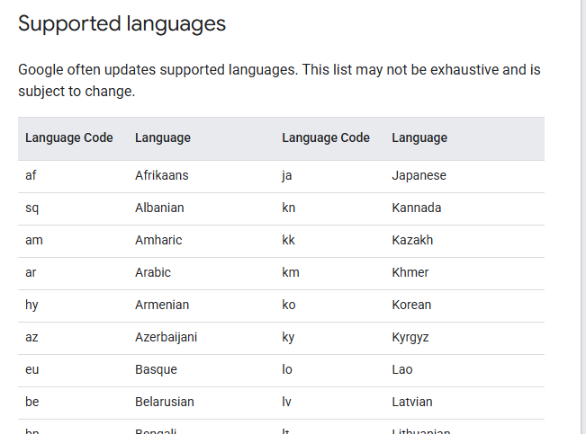

## Language Settings

Set the language in `config/settings.toml`. English (`en`) is the default.

```toml
[browser]
language = "ja"
```

For Python usage: `main.run("cafes", language="fr")`

Common language codes:

| Language | Code |
|---|---|
| English | `en` |
| Japanese | `ja` |
| Korean | `ko` |
| French | `fr` |
| German | `de` |
| Spanish | `es` |
| Chinese (Simplified) | `zh-CN` |

For other languages, see [Google Maps language codes](https://developers.google.com/maps/documentation/javascript/localization#Language).

Look for the **Supported languages** table on the linked page, as shown below.
The screenshot shows part of the table; refer to the page for the current list.

[](https://developers.google.com/maps/documentation/javascript/localization#Language)

The setting applies to Chrome, Google Maps, and Nominatim. Language availability and returned content depend on each service.
